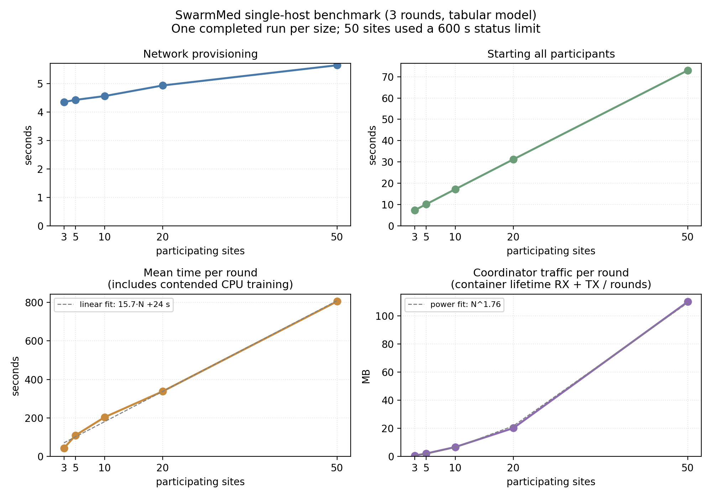

# Scalability

Real consortia are larger than the three sites used in the worked example. This
page reports what was measured as the number of participating sites grew from 3
to 50, how much of that was the platform's own cost, and what it implies for a
real study.

## How it was measured

Local-test networks of 3, 5, 10 and 20 clients, one three-round run each, on
22 September 2026, followed by two 50-client attempts on 9 October 2026. The first
50-client attempt aborted; the second completed with a longer status-report
deadline, as described below. The FLARE server and every client ran as Docker
containers on a single host, CPU only, connected by a Docker bridge network. The host was the
one that coordinated the worked example (24 CPU cores, 62 GiB of RAM), which also
ran the live Hub stack. The model was the small tabular example in
`examples/pytorch` (2,689 parameters, about 11.5 kB), and every client trained 5
epochs per round on the same 1,000-row synthetic dataset.

The tiny model was meant to make per-round time a measurement of coordination. It
did not: that training takes about a second when a client runs alone, but all
clients trained at the same time on the same CPUs, and the resulting contention,
not coordination, filled most of each round (see [Results](#results)). Running
everything on one host excludes wide-area links but introduces resource sharing
between sites. The total round times therefore do not isolate coordination or
predict performance when each site has its own hardware.

The benchmark differs from the worked example as follows:

| | Benchmark | Worked example |
|---|---|---|
| Runtime image | `swarmcloud-app:latest`, the platform's own image (NVFlare 2.7.1, PyTorch 2.10) | `odelia:paper-apr2026` (`jefftud/odelia@sha256:35b600ea…`; MediSwarm's fork of NVFlare, PyTorch 2.2.2) |
| Compute | CPU only | one GPU per site |
| Hosts | FL server and all clients on one host | three training hosts, plus a fourth for the platform and the FL server, connected over a Tailscale overlay |
| Model and data | tabular, about 11.5 kB; the same 1,000 rows at every client | MST, 94 MB checkpoint; each site its own share of the Duke breast-MRI data |
| Rounds | 3 | 20 |

The numbers come from a benchmark script that is not in the repository. It ran
the CLI inside the Hub's app container, the supported way to run it on a Hub
host, and for each N it:

1. created the network, timed as provisioning:

    ```bash
    docker exec -w /app swarmmedhub python3 -m swarmed_cli.main \
        network create --user <hub-user> --project <ID> --name scale-20 --local-test --clients 20
    ```

2. started the network by calling the start task directly in a Django shell in
   the app container, not through the worker queue, with the runtime image forced
   to `swarmcloud-app:latest` (`SWARMMEDHUB_FLARE_IMAGE`,
   `SWARMMEDHUB_FORCE_CONFIGURED_IMAGE=true`) and GPUs switched off
   (`SWARMMEDHUB_ENABLE_GPU=false`), timed as start;
3. submitted a job with `training start --network <NET>` and
   `SWARMMEDHUB_SWARM_ROUNDS=3`, timed as job submission;
4. timed from the end of job submission until the FLARE server's container log
   showed `Server runner finished`, checked every 10 s; mean round is this time divided
   by three, including training, coordination, shutdown and polling delay;
5. took one `docker stats` reading of the network's containers for network
   traffic.

The figure is in `docs/assets/scalability/` and the analysis script is
`experiments/duke_mst_cli/build_scalability_report.py`. The raw measurements
(`results/scalability/scalability_raw.csv`, `benchmark.log` and `n50_logs/`) and
the FLARE logs used for the breakdown below are not in the repository, because `results/` and
`workspaces/` are git-ignored.

## Results

| Sites | Provisioning (s) | Start all (s) | Job submit (s) | Mean round (s) | Coordinator traffic/round (MB) |
|---|---|---|---|---|---|
| 3 | 4.4 | 7.3 | 12.5 | 43 | 0.7 |
| 5 | 4.4 | 10.1 | 12.5 | 110 | 2.1 |
| 10 | 4.6 | 17.2 | 12.6 | 204 | 6.8 |
| 20 | 4.9 | 31.2 | 12.9 | 338 | 20.2 |
| 50 | 5.6 | 73.0 | 8.1 | 804 | 110.0 |

Only completed runs appear in the table and fits. The 50-site result used
`SWARMMEDHUB_SWARM_MAX_STATUS_REPORT_INTERVAL=600`; the smaller runs used
NVFlare's defaults. There is one completed run per size, so these measurements
do not establish run-to-run variability or a capacity limit.



**Provisioning and submission**

* *Provisioning* ranged from 4.4 to 5.6 s across the completed runs.
* *Job submission* took 12.5–12.9 s at 3–20 sites and 8.1 s at 50 sites. These
  timings include connecting to the FLARE server.

**Linear in the number of sites**

* *Starting the participants*, about 1.4 s per site: the platform launches the
  server and client containers one after another, about 1.4 s each. Registration
  with the server finishes a few seconds after the measured interval (at 20 sites
  the last client registered about 6 s after it ended). Paid once per network
  start.

**Mostly local training, not coordination**

* *Time per round* has a descriptive linear fit of 15.7·N + 24 s over all five
  sizes. The earlier fit to 3–20 sites predicted about 847 s at 50 sites; the
  completed run measured 804 s. This fit includes training. At 3–20 sites, most
  of the measured time (86–98 %) fell within local training on the shared CPUs.
  In the FLARE logs, local training (from the first client starting to the
  last client finishing) took a mean of 37, 105, 199 and 329 s per round at 3, 5,
  10 and 20 sites. In the final round at three sites, the span was only 2.1 s.
  The hand-off between rounds
  (aggregation and passing the model on through the server) took 0.8–2.1 s at
  each size from 3 to 20 sites. This breakdown has not been repeated at 50 sites.
  The swarm workflow requires every site's response to complete a round.

**Faster than linear**

* *Coordinator traffic* (bytes in plus out of the FLARE server container since it
  started, read once after the run and divided by the three rounds) grew roughly
  as N^1.76 across the five completed runs. At 50 sites the server received
  185 MB and sent 145 MB, giving 110 MB per round. With an 11.5 kB model, model
  updates account for only a small part of the recorded traffic. The counters
  also include registration, job deployment and control messages. At 3–20 sites,
  the earlier logs showed the effect of run duration on traffic:
  each site's traffic grew with how long the run lasted, from 0.8 MB per
  site in the 2-minute run at 3 sites to 3.1 MB per site in the 17-minute run at
  20 sites, and the runs lasted longer at larger N because of the contention
  above. The fitted exponent therefore does not describe model-payload scaling.
  Model updates are relayed through the coordinating host rather than sent site
  to site (see
  [Threat model](threat-model.md#3-the-coordinating-host-sees-model-updates-default-configuration));
  for a real model that payload dominates and grows linearly with N.

## The 50-site status timeout

The first 50-site attempt aborted during the third round. Its server log records
`client fl-client-48 didn't report status for 90.0 seconds`. NVFlare 2.7.1's
server controller defaults to a 90 s maximum interval between received client
status reports and a separate 3,600 s progress timeout. The log establishes a
missed status-report deadline; it does not establish why reports stopped.
The aborted attempt is retained in the raw CSV with status `aborted` and is
excluded from the completed-run table and figure.

SwarmMed now exposes the server limits through
`SWARMMEDHUB_SWARM_MAX_STATUS_REPORT_INTERVAL` and
`SWARMMEDHUB_SWARM_PROGRESS_TIMEOUT`, both in seconds. For the rerun, the generated
server configuration contains `max_status_report_interval: 600.0`. All three
rounds completed in 2,412 s, or 804 s per round. Only the status limit was raised;
600 s is a measured setting for this benchmark, not a general recommendation.

Set the override in the process that submits the job, before submission. For a
CLI submission on a Hub host:

```bash
docker exec -w /app \
    -e SWARMMEDHUB_SWARM_MAX_STATUS_REPORT_INTERVAL=600 \
    -e SWARMMEDHUB_SWARM_ROUNDS=3 \
    swarmmedhub python3 -m swarmed_cli.main \
    training start --user <hub-user> --network <NET>
```

For a web submission, the variable must be in the app process's environment.
These overrides configure the server controller; they do not expose the
client-side task deadlines.

## What this means for a real study

For the breast-MRI example (94 MB checkpoint), each round the model goes out to
the N − 1 sites other than the one sending it, and N − 1 updates come back to that
round's aggregating site. Every copy passes through the coordinating host, so it
receives about `2 × (N − 1) × 94 MB` per round and sends the same amount on; its
link carries twice that in total. At the end of a study the final model goes out
once more.

| Sites | Each direction, per round | Each direction, 20 rounds + final distribution |
|---|---|---|
| 3 | 0.38 GB | 7.7 GB |
| 5 | 0.75 GB | 15 GB |
| 10 | 1.7 GB | 35 GB |
| 20 | 3.6 GB | 73 GB |
| 50 | 9.2 GB | 189 GB |

These values are computed from the relay pattern, not measured (decimal GB; the
20-round column includes the final distribution). The 50-site measurement above
used the tiny tabular model, not MST. The measurement with the MST model, from
the worked example (3 sites, 20 rounds), recorded 9.76 GB received and 9.38 GB sent at the coordinating
server over the container's lifetime, which also included a 2-round smoke job,
against about 8.7 GB in each direction expected for the two jobs.

For a realistic study the practical limits are:

1. **The slowest site.** The platform always waits for every site in every round
   (the swarm controller's minimum number of responses is fixed at the number of
   sites), so one site with less GPU, more data or a slower link sets the pace for
   the whole consortium every round. How much this costs was not measured here,
   because all simulated sites ran identical work on one host.
2. **Coordinator bandwidth.** At 20 sites and a 94 MB model the coordinating host
   relays roughly 73 GB in each direction (about 146 GB in total) over a 20-round
   study; at 50 sites, about 189 GB in each direction. Plan the coordinating
   site's link accordingly, and prefer a smaller model where the science allows
   it.
3. **Coordination and time limits.** The measured gap between rounds was
   0.8–2.1 s at 3–20 sites, with a model too small for transfer time to matter.
   At 50 sites the default status deadline caused an abort. The completed rerun
   shows that a longer deadline was sufficient for this workload; it does not
   validate larger consortia, wide-area links or large models at that size.

For comparison, a round of the worked example (three sites, 94 MB model) took
about 9 minutes. Up to 20 sites, the platform's own start-up and between-round
costs measured here are small next to that. Beyond that, the wait-for-all pattern
and the relay topology are the things to revisit. Tolerating late sites would
need a platform change: SwarmMed does not currently let a round close without
every site.

## A limitation found while measuring this

Every 60 s the platform's job-monitoring task attempts blocking NVFlare admin
sessions for networks in RUNNING, STARTING or PROVISIONED state and for running
jobs with a local workspace and an admin target. Runs can overlap. During the
September measurements, when completed jobs were also polled, three registered
networks and their jobs were enough to occupy the worker's eight slots. Network
starts queued behind them.

Since 9 October 2026, completed jobs are no longer polled. The per-network
sessions remain, and registered networks accumulate over time, so this is still a
limit on how many studies one installation can host concurrently, independent of
how many sites each study has. How many networks it now takes to fill the worker
slots has not been measured. Stopping a network now also marks its unfinished
jobs STOPPED, removing both from the monitor's admin-session polling.
